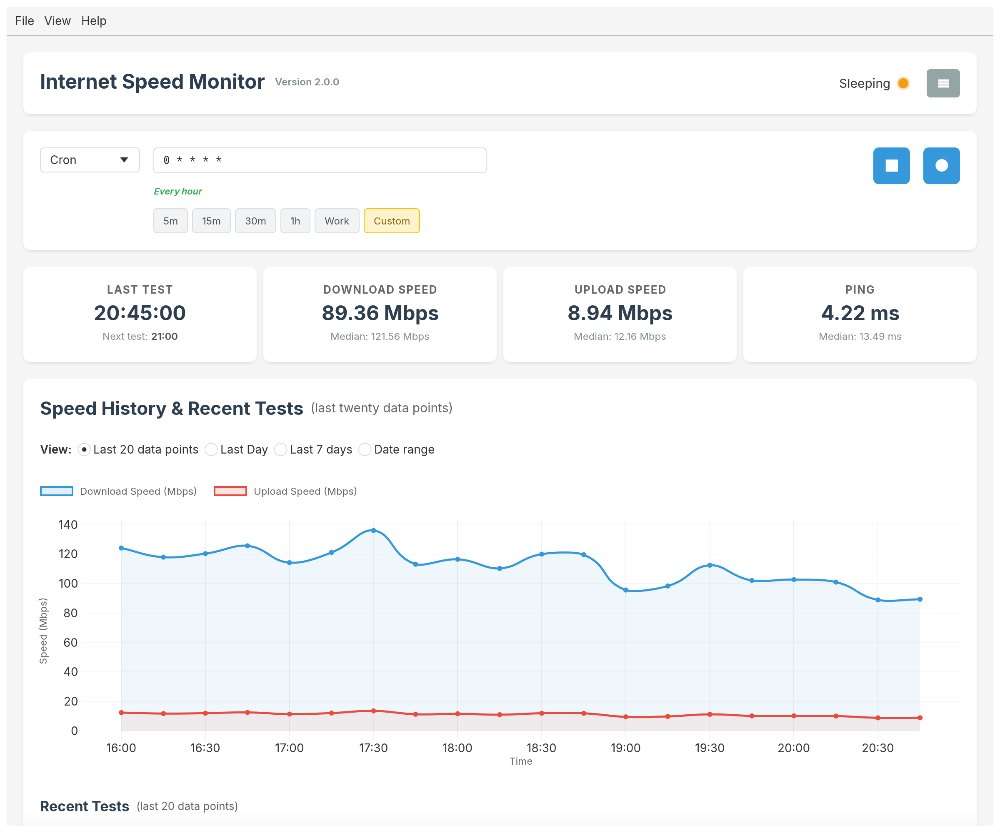
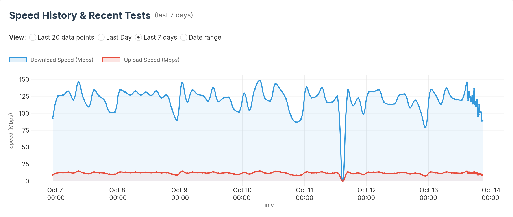
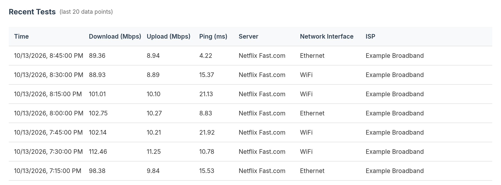
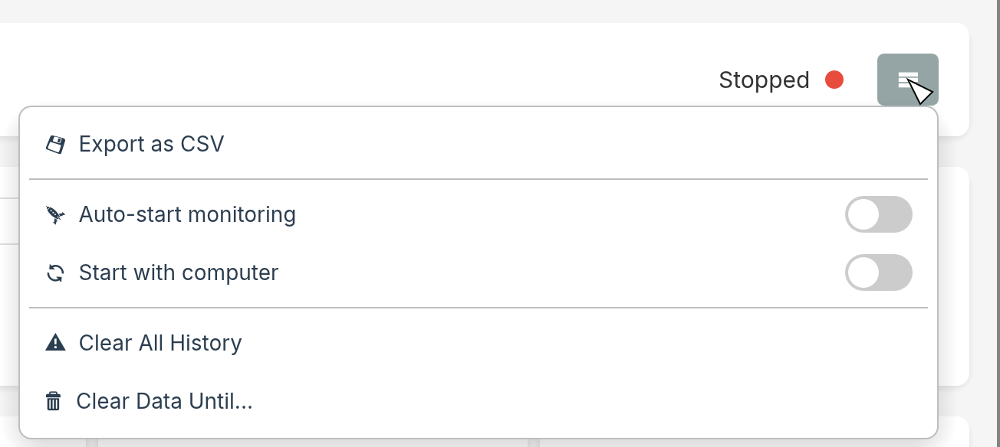
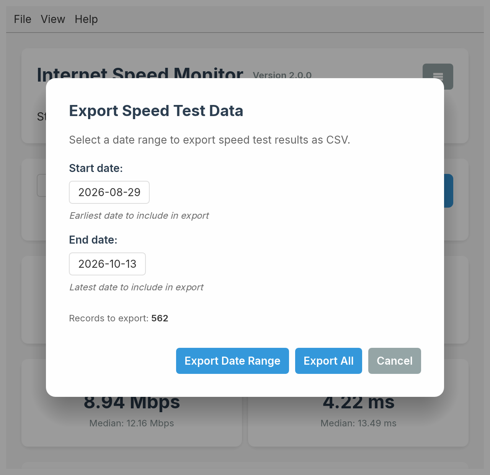
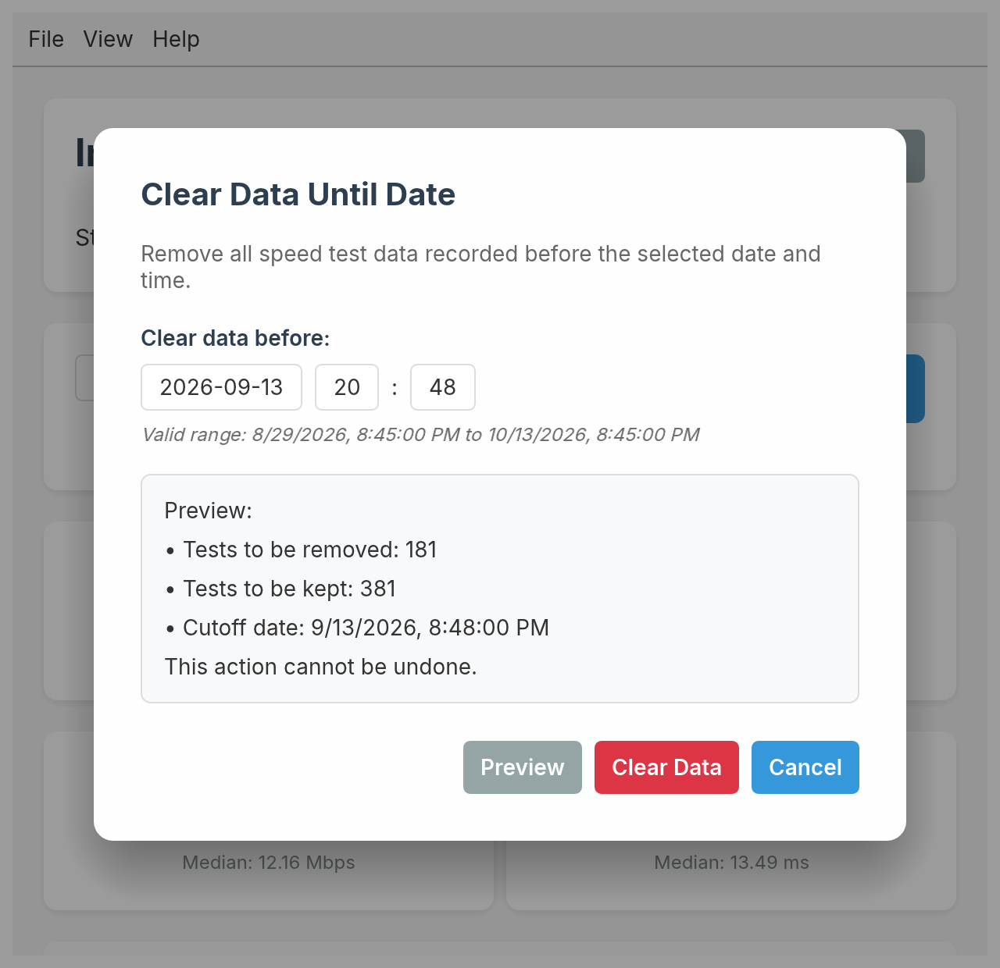

# Internet Speed Monitor

A beautiful, easy-to-use desktop application that monitors your internet connection speed automatically and helps you track your network performance over time. Written in Rust, it ships as a small native binary with no runtime dependencies.



## ✨ Features

- **🚀 Advanced Scheduling** - Choose between Simple Interval or flexible Cron Expression scheduling
- **⚡ Smart Presets** - Quick-access buttons for common schedules: 5m, 15m, 30m, 1h plus Work hours preset for cron mode
- **🕒 Cron Support** - Full UNIX cron expression support with real-time validation and helpful descriptions
- **⚡ Instant Testing** - "Test Once Now" button for on-demand speed tests without starting monitoring
- **📊 Real-time Charts** - Beautiful visualizations of your internet speed over time (last 20 data points, last day, last 7 days or any date range)
- **📈 Performance Tracking** - Keep detailed history of download speeds, upload speeds, and ping
- **📐 Median Statistics** - Track median performance across your recent history for better insights
- **⏱️ Smart Status Indicators** - Real-time display of test status with the time of the next scheduled test
- **💾 Local Storage** - All your data stays on your device - no cloud required
- **📤 Easy Export** - Export your speed data (all of it, or a date range) to CSV for further analysis
- **🧹 Data Management** - Clear history entirely or up to a chosen date, and manage debug logs
- **🎨 Clean Interface** - Modern, responsive design
- **🔄 Cross-platform** - Available for Windows, macOS, and Linux
- **🪶 Lightweight** - Native Rust application: fast start-up, tiny memory footprint, single binary

## 📸 Screenshots

### Speed history
Switch the chart between the last 20 tests, the last day, the last 7 days or any date range.



### Recent tests
Every result is kept with its server, network interface and ISP.



### Options menu
Export, auto-start, launch at login and history cleanup live behind the ☰ button.



### Export and cleanup

<table>
  <tr>
    <td width="50%" valign="top">
      <br>
      <sub>Export everything, or just a date range, to CSV.</sub>
    </td>
    <td width="50%" valign="top">
      <br>
      <sub>Preview exactly what will be removed before clearing old data.</sub>
    </td>
  </tr>
</table>

## 🚀 Quick Start

### Download & Install

#### Option 1: Direct Download (Most Users)
1. **Go to [Releases](https://github.com/omrilotan/internet-speed-monitor/releases)**
2. **Download for your platform:**
   - 🍎 **macOS**: Download the `.dmg` file for your chip (`arm64` for Apple Silicon, `x64` for Intel)
   - 🪟 **Windows**: Download `Internet Speed Monitor Setup <version>.exe` (or the portable `.zip`)
   - 🐧 **Linux**: Download the `.deb` package or the `.tar.gz` binary

3. **Install and run** - Double-click the downloaded file and follow the installation prompts

#### Upgrading from 1.x

Install 2.x the usual way. Your speed test history and settings carry over, and the old version is cleaned up:

- **macOS** - Drag the new app into Applications and choose **Replace**.
- **Windows** - The Setup installer closes and removes 1.x for you, and keeps "Start with computer" if it was on.
- **Linux (.deb)** - `sudo apt install ./internet-speed-monitor_<version>_amd64.deb` upgrades the 1.x package in place.
- **Portable / AppImage** - Delete the old file yourself; there is nothing to uninstall.

Before 2.x first writes to your history it saves an untouched copy as `speed_tests.backup-1.x.json` in the app storage folder (Help → Open App Storage Folder). Files Electron left in that folder (caches, browser storage) are removed on first launch.

#### Option 2: Homebrew (macOS - Recommended for avoiding security dialogs)
```bash
# Add this repository as a tap
brew tap omrilotan/internet-speed-monitor

# Install the app
brew install --cask internet-speed-monitor
```

#### Option 3: Build from Source
You need a [Rust toolchain](https://rustup.rs/) (stable, 1.88 or newer).

```bash
# Clone the repository
git clone https://github.com/omrilotan/internet-speed-monitor.git
cd internet-speed-monitor

# Run in development
cargo run

# Build an optimised binary (target/release/internet-speed-monitor)
cargo build --release

# Or build a macOS .app / Linux .deb bundle
cargo install cargo-bundle
cargo bundle --release
```

On Linux you also need the usual desktop build packages, for example on Debian/Ubuntu:

```bash
sudo apt-get install -y libgtk-3-dev libxkbcommon-dev libwayland-dev libssl-dev pkg-config
```

### 🍎 macOS Security Dialogs

macOS may show security warnings like "cannot verify the app is free of malware" or "app is damaged". This is normal for apps not distributed through the Mac App Store. The app is completely safe and open source.

**📋 Solutions (choose any one):**

**🎯 Best Solution: Use Homebrew** (No security dialogs)
```bash
brew tap omrilotan/internet-speed-monitor
brew install --cask internet-speed-monitor
```

**Method 1: Right-click to Open**
1. **Right-click** (or Control-click) the app in Finder
2. **Select "Open"** from the context menu
3. **Click "Open"** in the security dialog

**Method 2: System Preferences**
1. Open **System Preferences** → **Security & Privacy** → **General**
2. Click **"Open Anyway"** next to the blocked app message
3. **Confirm** by clicking "Open"

**Method 3: Terminal Command** (Advanced Users)
```bash
sudo xattr -rd com.apple.quarantine "/Applications/Internet Speed Monitor.app"
```

**Method 4: Build from Source** (No security warnings)
```bash
git clone https://github.com/omrilotan/internet-speed-monitor.git
cd internet-speed-monitor && cargo run --release
```

This is normal for apps not distributed through the Mac App Store. The app is safe and open source.

### Using the App

1. **Choose Schedule** - Select Simple Interval presets or create custom Cron expressions for precise timing
2. **Start Monitoring** - Click the ▶ button to begin automatic testing
3. **Test Instantly** - Use the ● button for immediate speed testing without starting monitoring
4. **Watch Status** - Monitor real-time status with next-test time and running indicators
5. **View Your Data** - See current speeds, median statistics, charts, and detailed history
6. **Manage Data** - Export results, clear history, or manage debug logs from the ☰ menu and the Help menu

## 🎯 Perfect For

- **Home Users** - Monitor your ISP's actual performance vs. promised speeds
- **Remote Workers** - Ensure stable internet for video calls and productivity
- **Gamers** - Track connection quality for optimal gaming performance
- **Content Creators** - Monitor upload speeds for streaming and file sharing
- **IT Professionals** - Document network issues with historical data
- **Students** - Ensure reliable internet for online classes and research

## 📋 What You'll See

- **Current Speed Stats** - Live download speed, upload speed, and ping measurements
- **Median Performance** - Median statistics showing your typical internet performance over time
- **Smart Status Display** - Real-time indicators showing monitoring status with visual feedback
- **Next Test Time** - The clock time of your next automatic test
- **Test Running Indicator** - Visual feedback when speed tests are actively running
- **Historical Charts** - Trend graphs showing your internet performance over time
- **Recent Test Results** - Detailed table of your most recent speed tests with server, network interface and ISP information
- **Export & Management** - Save data as CSV files and manage your test history and debug logs

## 🔒 Privacy & Security

- **Local Storage Only** - All data stays on your computer
- **No Tracking** - We don't collect any personal information
- **Open Source** - Full transparency with public source code
- **Secure Testing** - Uses Netflix's Fast.com service for reliable speed measurements

## 🛠️ System Requirements

- **Windows**: Windows 10 or later
- **macOS**: macOS 10.15 (Catalina) or later
- **Linux**: A desktop with OpenGL and X11 or Wayland (Ubuntu 20.04+, Fedora 34+, etc.)
- **Memory**: 50MB RAM
- **Storage**: 20MB free space

## 📞 Support & Help

Having issues? We're here to help!

1. **Check Common Solutions** - Most issues are covered in our [troubleshooting guide](CONTRIBUTING.md#troubleshooting)
2. **Report Bugs** - Open an [issue on GitHub](https://github.com/omrilotan/internet-speed-monitor/issues) with details
3. **Request Features** - We love hearing your ideas for improvements!

## 🤝 Contributing

Want to help make Internet Speed Monitor even better? We welcome contributions!

- **Report Bugs** - Found something broken? Let us know!
- **Suggest Features** - Have ideas for improvements? Share them!
- **Contribute Code** - Check our [Contributing Guide](CONTRIBUTING.md) for technical details

## 📜 License

This project is released into the public domain under the UNLICENSE - feel free to use, modify, and distribute without any restrictions!

The bundled [Inter](https://rsms.me/inter/) font is licensed under the SIL Open Font License 1.1 (see `fonts/LICENSE-Inter.txt`).

---

**Download now and take control of your internet monitoring!** 🌐✨
